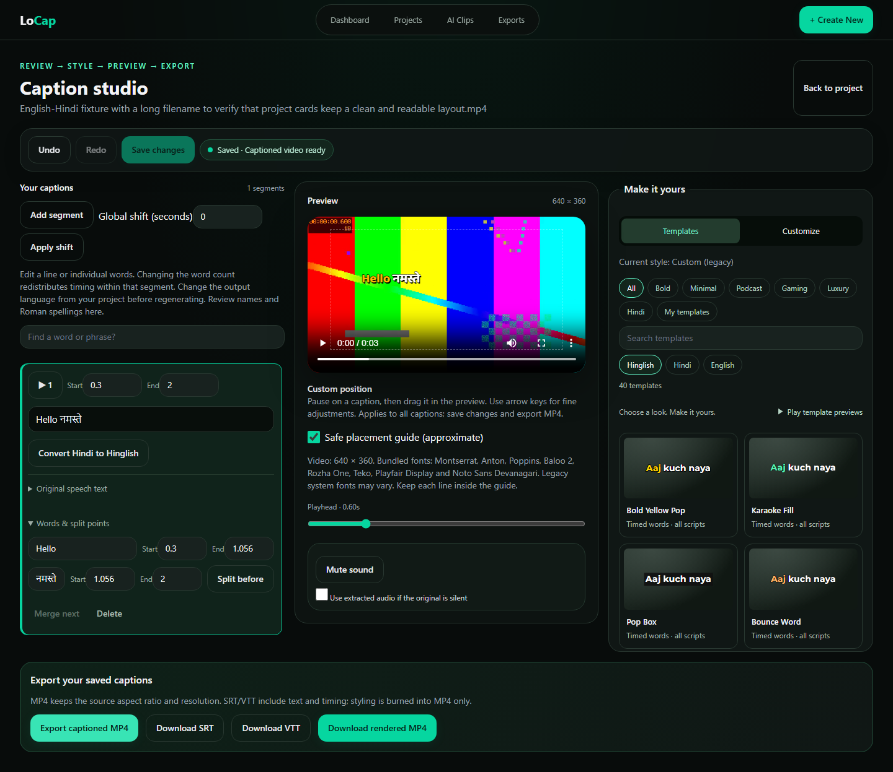
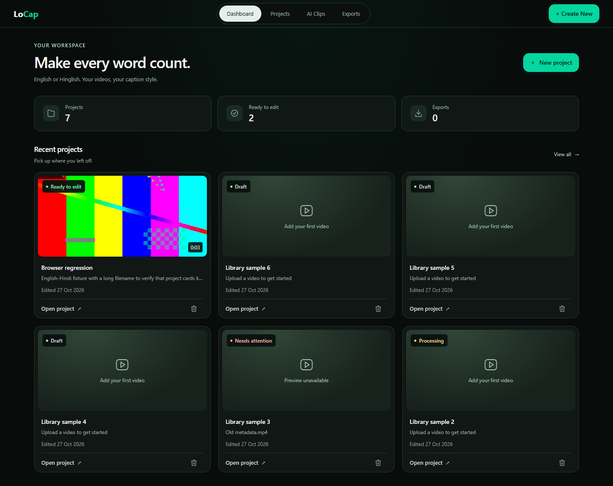
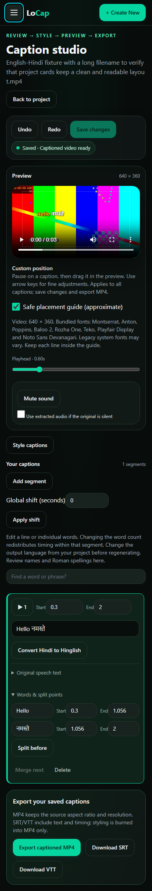
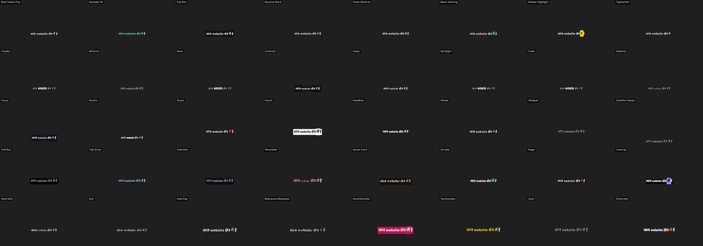
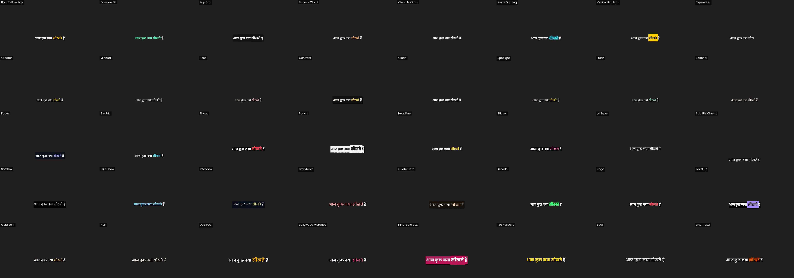
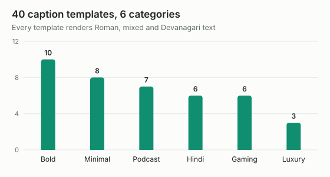
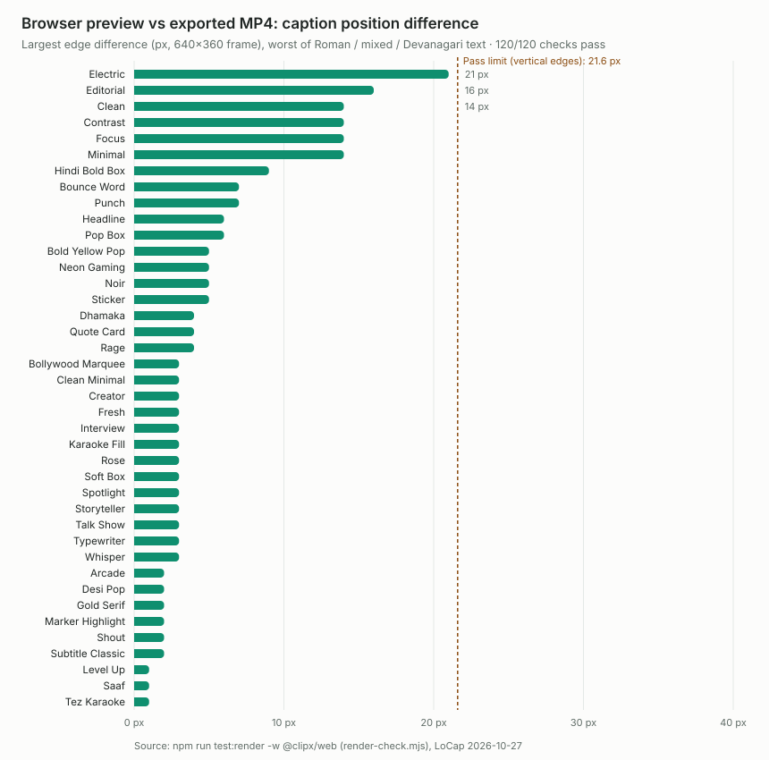

<div align="center">

# LoCap

**Local-first AI captions for Hinglish, Hindi and English videos.**

Upload a video, get captions timed word by word, polish every word in a studio built for mixed-script speech, and export a captioned MP4 or SRT/VTT. Speech recognition, alignment and Hinglish conversion all run on your own machine.


</div>



---

## Why LoCap

Most caption tools treat Hinglish as an afterthought. LoCap is built around how creators in India actually talk: Hindi and English in the same sentence, names and brand terms that generic models miss, and audiences that read either Roman or Devanagari script.

| | |
|---|---|
| **Hinglish first** | Per-window Hindi/English recognition, then word-by-word conversion to natural Roman Hinglish (`आज website बनाते हैं` → `aaj website banate hain`) with timings preserved. |
| **Word-accurate timing** | Silero VAD speech windows plus WhisperX wav2vec2 forced alignment for Hindi and English runs. Words that cannot be aligned are flagged for review, never silently guessed. |
| **Your vocabulary** | Add names and phrases (for example `Minecraft, search bar`) and they guide the decoder; sound-alike corrections are only accepted when the audio confirms them. |
| **40 caption templates** | Six categories with search, live previews in Hinglish, Hindi or English, and your own saved templates. |
| **What you see is what you export** | The browser preview and the FFmpeg/libass export share one presentation model; an automated check compares them frame by frame. |
| **Runs locally** | No cloud speech API, no upload to third parties. Your media stays on your disk. |

## Screenshots

<table>
<tr>
<td width="62%"></td>
<td width="38%"></td>
</tr>
<tr>
<td><sub>Dashboard: posters, status, duration and quick search.</sub></td>
<td><sub>The full studio works on a phone.</sub></td>
</tr>
</table>

<sub>Screenshots use the synthetic test fixtures from the browser regression suite.</sub>

### Template library

Every template, exported by FFmpeg with a mixed Hindi/English line:



<details>
<summary>Same templates with Devanagari text</summary>



</details>

<picture>
  <source media="(prefers-color-scheme: dark)" srcset="docs/images/chart-templates-dark.svg">
  
</picture>

## Performance and quality

### Preview matches export

The render check renders every template with Roman, mixed and Devanagari text (120 cases), exports it with FFmpeg, screenshots the same frame in the browser, and compares the caption's bounding box. All 120 pass; the largest difference is 21 px on a 640×360 frame.

<picture>
  <source media="(prefers-color-scheme: dark)" srcset="docs/images/chart-render-match-dark.svg">
  
</picture>

### Recognition and timing (sample project)

Measured on a 126.85-second Hinglish gaming tutorial after vocabulary hints:

| Metric | Result |
|---|---|
| Words recognised | 265 |
| Words force-aligned to audio (WhisperX) | **238 (89.8%)** |
| Words keeping estimated timing, flagged for review | 27 (10.2%) |
| Caption groups | 77 |
| Non-Roman letters left in Hinglish captions | 0 |
| User-reported misrecognitions fixed (then, pehli, search bar, bina, Minecraft) | 5 of 5 |

A word-error-rate benchmark on hand-corrected reference videos, plus GPU acceleration, is designed and scheduled; see [Roadmap](#roadmap).

### Test suite

| Suite | Passing |
|---|---|
| Captions package (templates, fonts, presentation, documents) | 32 |
| AI package (transcription, Hinglish conversion, script guards) | 28 |
| Video engine (probe, cut, reframe, ASS, burn-in for all 40 templates) | 18 |
| Worker (pipeline, exports, caption flow) | 12 |
| Browser regression (Playwright, desktop + mobile) | 5 groups |
| Render check (browser vs FFmpeg) | 120 / 120 |

## How it works

```mermaid
flowchart LR
  U[Upload video] --> W[(Job queue<br/>SQLite)]
  W --> P[Worker]
  P --> A[FFmpeg<br/>16 kHz audio + cleanup]
  A --> V[Silero VAD<br/>speech windows]
  V --> R[Faster Whisper<br/>per-window Hindi/English]
  R --> L[WhisperX<br/>wav2vec2 alignment]
  L --> H[Qwen via Ollama<br/>Hinglish word mapping]
  H --> C[Caption document<br/>words + timing + style]
  C --> S[Caption studio<br/>edit, style, position]
  S --> E[FFmpeg + libass<br/>MP4 / SRT / VTT]
```



| Layer | Technology |
|---|---|
| Web app | Next.js 14 App Router, React 18, Tailwind CSS |
| Worker | Node.js job runner polling Prisma (one job at a time) |
| Data | Prisma + SQLite (PostgreSQL-ready schema) |
| Storage | Local filesystem or any S3-compatible store (MinIO, AWS, R2) |
| Speech | faster-whisper 1.2.1 (CTranslate2), Silero VAD, WhisperX 3.8.6 |
| Hinglish | Qwen 3.5 9B via Ollama, constrained to one-word keyed mappings; rules fallback |
| Video | FFmpeg / ffprobe, libass subtitles, bundled OFL fonts (Latin + Devanagari) |
| Tests | Vitest, Python unittest, Playwright |

Monorepo layout:

```
apps/web        Next.js app and API routes
apps/worker     job runner: transcription, captions, exports
packages/ai     speech providers, Hinglish conversion, Python scripts
packages/captions   caption engine, 40 templates, font registry, SRT/VTT
packages/video-engine  FFmpeg operations, ASS builder, burn-in
packages/database   Prisma schema and client
packages/storage    local / S3 storage
packages/types, packages/config   shared contracts and limits
```

## Getting started

### Requirements

- Node.js 20+ and npm
- FFmpeg and ffprobe on `PATH`
- Python 3.11.9 (local speech recognition)
- [Ollama](https://ollama.com) with `qwen3.5:9b` for Hinglish conversion (optional; a rules-based mode works without it)

### Install

```bash
npm install
cp .env.example .env
npm run db:setup
```

Set up local speech recognition (Windows PowerShell):

```powershell
powershell -File infra/scripts/setup-local-transcription.ps1 -WithAlignment
```

Then in `.env`:

```dotenv
TRANSCRIPTION_PROVIDER=local
LOCAL_TRANSCRIPTION_MODEL=dropbox-dash/faster-whisper-large-v3-turbo
LOCAL_TRANSCRIPTION_ALIGNMENT=whisperx
AI_PROVIDER=ollama
```

### Run

```bash
npm run dev
```

Open http://localhost:3000. The web app and the worker start together.

### Test

```bash
npm run test
npm run typecheck
```

Browser and render checks use an isolated build:

```bash
cd apps/web
NEXT_BUILD_DIR=.next-verify npx next build
NEXT_BUILD_DIR=.next-verify npm run test:browser
NEXT_BUILD_DIR=.next-verify npm run test:render
```

More detail: [architecture](docs/architecture.md), [speech pipeline](docs/asr-pipeline.md), [caption templates](docs/caption-templates.md).

## Roadmap

- **Accuracy benchmark and GPU acceleration** (designed, on hold): word-error-rate scoring against hand-corrected references, CUDA float16 recognition and alignment, benchmark-driven model choice including Hindi-tuned checkpoints. [Spec](docs/superpowers/specs/2026-10-21-caption-accuracy-design.md) · [Plan](docs/superpowers/plans/2026-10-21-caption-accuracy.md)
- **Hindi (Devanagari) output** and a one-click Hinglish ↔ हिंदी switch in the studio.
- **Uncertain-word review**: jump through low-confidence words and play each in place.
- Production authentication (the current build uses a local demo user).

## Status

LoCap runs as a single-machine local application. Authentication is a local demo-user shortcut, not production login. Recognition quality depends on audio; names and fast code-switches can still need a quick review in the studio.

## Licence

Copyright © 2026 Karthik Shakyawar. All rights reserved.

This source is published for viewing only. No licence is granted to use, copy, modify or distribute it without written permission.

Bundled fonts and referenced third-party material keep their own licences; see [THIRD_PARTY_NOTICES.md](THIRD_PARTY_NOTICES.md).
